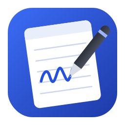
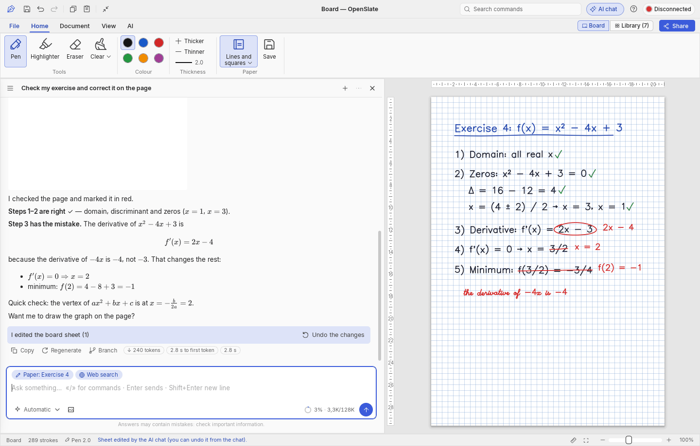
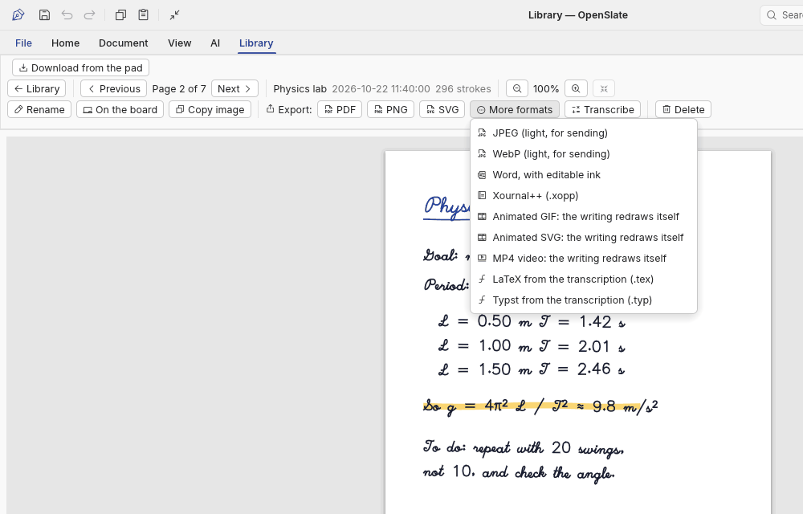
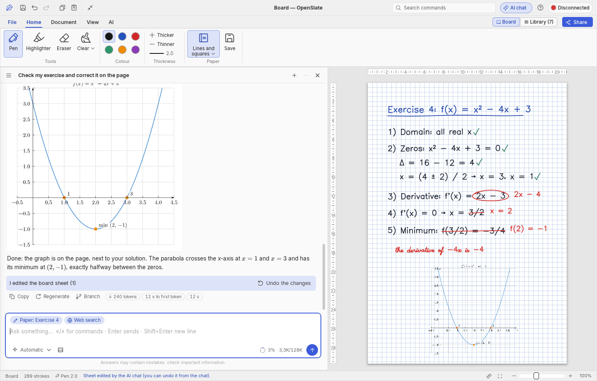
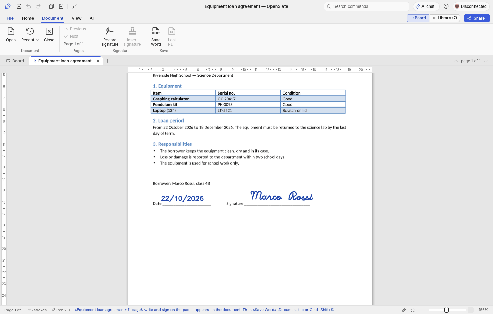
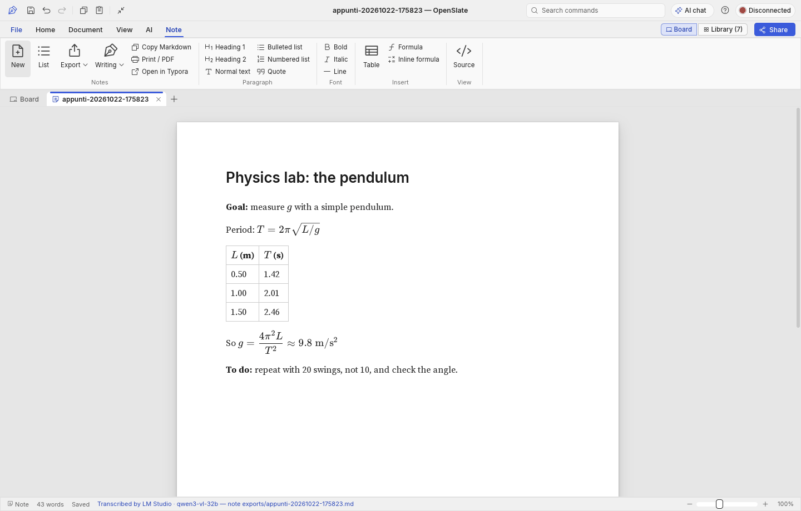
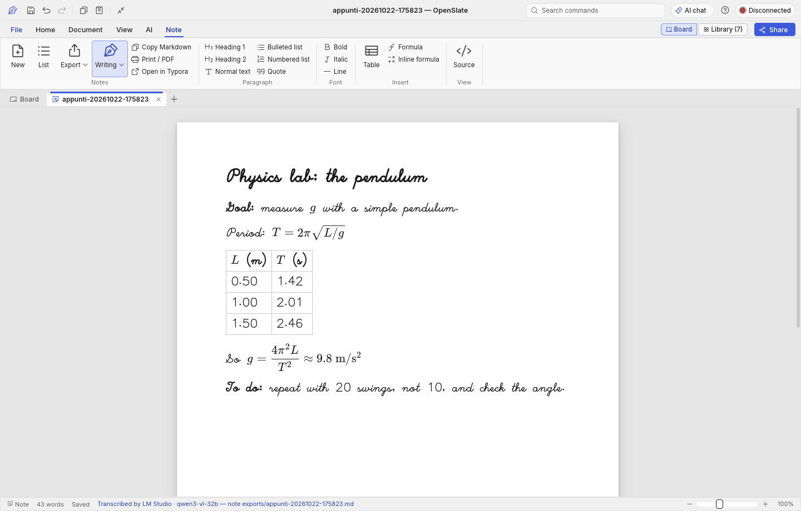
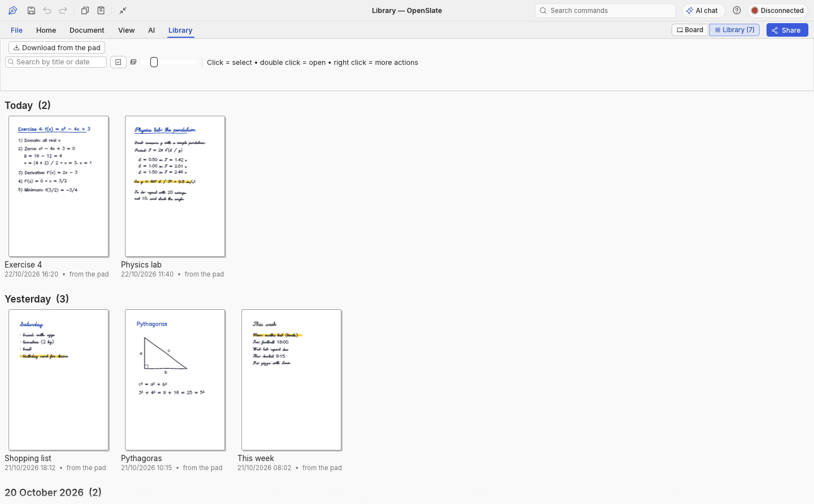
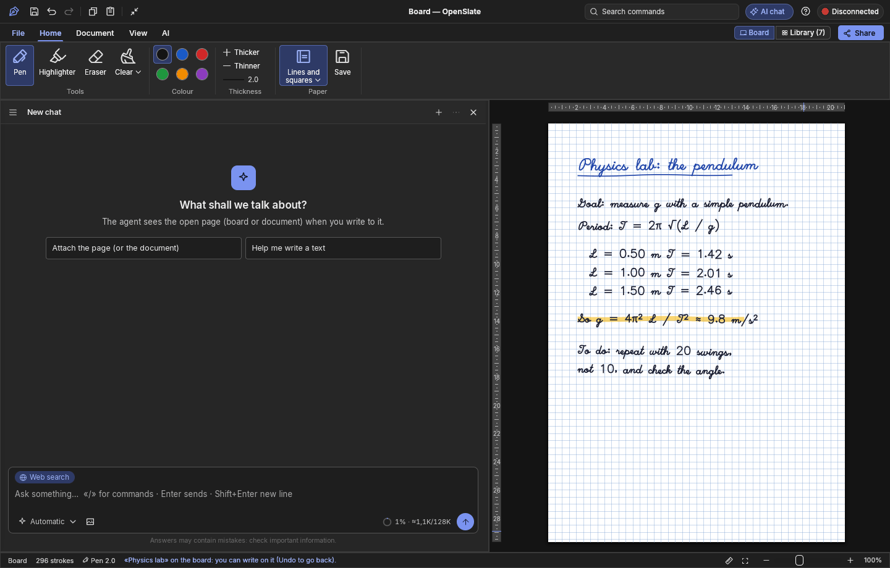

<p align="center">
  
</p>

<h1 align="center">OpenSlate</h1>

<p align="center">
  Eine freie Open-Source-Begleit-App für das <b>Wacom Bamboo Slate</b> (SmartPad-Familie).<br>
  Live-Tafel · Offline-Synchronisierung · Word- und PDF-Dokumente mit dem Stift unterschreiben · Handschrift zu Text · ein KI-Assistent, der deine Übungen direkt auf dem Blatt korrigiert
</p>

<p align="center">
  <a href="https://github.com/rmpaolillo/OpenSlate/releases/latest"></a>
  <a href="https://github.com/rmpaolillo/OpenSlate/actions/workflows/ci.yml"></a>
  <a href="LICENSE"></a>
</p>

*[English](README.md) · [Italiano](README.it.md) · [Español](README.es.md) · [Français](README.fr.md) · Deutsch · [Українська](README.uk.md) · [中文](README.zh.md) · [日本語](README.ja.md) · [한국어](README.ko.md)*

<p align="center">
  
</p>

---

## Warum es dieses Projekt gibt

Ich besitze ein Bamboo Slate und benutze es jeden Tag: zum Schreiben, zum Durcharbeiten von Übungen und zum Unterschreiben
von Dokumenten. Wacom hat für Inkspace, die App, von der das Pad abhängt, [das Ende des Supports angekündigt](https://support.wacom.com/hc/en-us/articles/36070902398231-Bamboo-Paper-Inkspace-Wacom-Notes-application-End-of-Life-Notification),
und so drohte die Hardware zum Briefbeschwerer zu werden.

Also habe ich meine eigene App gebaut, für meine eigenen Bedürfnisse. **OpenSlate ist ein „vibe-coded“ Projekt**: Ich habe beschrieben,
was ich wollte, und es zusammen mit einem KI-Programmierassistenten ([Claude](https://claude.ai)) geschrieben,
schrittweise anhand der echten Nutzung statt nach einem großen Entwurf von vornherein. Für mich funktioniert es unter
macOS gut. Ich teile es, falls es anderen Slate-Besitzern nützt. Rechne mit Ecken und Kanten und mit Code-Kommentaren
auf Italienisch (die Oberfläche selbst ist in neun Sprachen übersetzt).
Issues und Pull Requests sind willkommen: siehe [CONTRIBUTING.md](CONTRIBUTING.md).

> OpenSlate ist ein unabhängiges Projekt. Es ist **nicht mit Wacom verbunden und wird von Wacom weder unterstützt
> noch empfohlen**. „Wacom“, „Bamboo“ und „Inkspace“ sind Marken ihrer jeweiligen Inhaber.

## Auf einen Blick

- **Auf Papier schreiben, auf dem Bildschirm sehen.** Das Bamboo Slate überträgt jeden Strich per Bluetooth;
  Seiten, die du fern vom Computer geschrieben hast, werden später in ein Archiv heruntergeladen.
- **Ein KI-Tutor, der auf dein Blatt schreibt.** Bitte ihn, eine Übung zu prüfen: Er hakt ab, was richtig ist,
  kreist den Fehler ein und schreibt die Korrektur handschriftlich daneben, dann erklärt er sie im
  Chat, mit Formeln. Er kann auch den Graphen einer Funktion aufs Blatt zeichnen.
- **Word- und PDF-Dokumente mit dem Stift unterschreiben**, gespeichert im selben Format.
- **Handschrift → bearbeitbare Notizen**, mit Tabellen und Formeln, exportiert als Markdown, Word oder PDF,
  gedruckt oder in einer Handschrift-Schriftart.
- **Export in das, was du brauchst**: durchsuchbares PDF, Word mit der Handschrift als bearbeitbare Tinte, leichte JPEG/WebP, Xournal++, ein animiertes GIF, SVG oder MP4-Video der Seite, die sich schreibt, und LaTeX oder Typst aus der Transkription.
- **Die KI deiner Wahl**: lokale Modelle (LM Studio, Ollama) oder Cloud-Anbieter; API-Schlüssel werden nie
  im Klartext gespeichert.
- **Mit dem Chat sprechen.** Diktieren per Mikrofon: Whisper transkribiert auf deinem Computer, offline.
- **Der Tutor antwortet laut** mit den Stimmen des Systems und prüft dich auf Wunsch beim Schreiben:
  bei der ersten Pause markiert er Fehler auf dem Blatt.
- **Schöne Schrift**, wenn du willst: gerade Zeilen, glatte Striche und gleichmäßige Wörter auf dem
  Bildschirm und im Export; deine echten Striche bleiben unverändert.
- **Frei und Open Source**, in neun Sprachen, für macOS (Hauptplattform), Linux und Windows.

## Funktionen

- **Live-Tafel.** Verbinde dich per Bluetooth und sieh, was du auf dem Pad schreibst, während du schreibst,
  im Vollbild. Du bekommst Stifte, einen Textmarker (`H`; das Umschalten per langem Druck mit dem Stift lässt sich in den Optionen einschalten), einen Radierer (ein
  Kritzel- oder Radiermodus), Farben, Strichstärken, Rückgängig/Wiederholen, Drehen/Spiegeln und Zoom mit
  Trackpad-Gesten.
- **Papierstile.** Wähle zwischen liniert, italienischen Grundschullineaturen, kariert (4/5/10 mm),
  Millimeterpapier, kartesischem Koordinatensystem, gepunktet, isometrisch, Notenlinien und Cornell-Notizen. Die Lineaturen
  werden in Originalgröße gezeichnet und erscheinen nur auf dem Bildschirm, sodass Exporte sauber bleiben.
- **Offline-Seiten.** Lade die Seiten, die du fern vom Computer geschrieben hast, in ein nach Tagen gruppiertes
  Archiv herunter. Von dort aus kannst du Seiten umbenennen, exportieren, per OCR erfassen oder aus dem Papierkorb wiederherstellen.
- **Word- und PDF-Dokumente unterschreiben.** Öffne eine `.docx`/`.doc`/`.odt`/`.rtf` oder eine `.pdf`, schreib oder
  unterschreib mit dem Stift darauf und speichere eine Kopie **im selben Format**. In einer Word-Datei wird die
  Handschrift zu Tinte im Dokument, sodass Word, Pages und LibreOffice sie alle anzeigen. In einer
  PDF wird sie zu Vektorstrichen über dem unveränderten Original. Die Seiten bleiben bei jedem Zoom scharf,
  gerendert von den Engines [WordCraft](https://github.com/storytold/wordcraft) und
  [PdfCraft](https://github.com/storytold/pdfcraft).
- **Auch auf Bildern schreiben.** Öffne ein SVG, PNG, JPEG (auch WebP, TIFF, BMP, GIF) oder drück **Einfügen**
  (`Cmd+V`) mit einem Screenshot oder Foto in der Zwischenablage. Schreib darauf und speichere es wieder als Bild
  im selben Format und in derselben Größe: Ein SVG behält die Handschrift als Vektorpfade
  ([VectorCraft](https://github.com/storytold/vectorcraft)), auf ein Foto wird sie in voller
  Auflösung gemalt, wobei sein Farbprofil erhalten bleibt ([PhotoCraft](https://github.com/storytold/photocraft)).
- **Kopieren und Einfügen wie in Word.** Die Registerkarte Start beginnt mit **Einfügen** und **Kopieren**: Kopieren legt die
  Seite als Bild in die Zwischenablage, bereit für den KI-Chat, Word oder eine E-Mail.
- **Handschrift → Text.** Ein bildfähiges KI-Modell transkribiert eine Seite originalgetreu, Fehler
  inklusive, in eine Markdown-Notiz: Überschriften, Listen, Kontrollkästchen, Tabellen und Formeln in LaTeX, wenn
  es welche gibt. Zeichnungen, Graphen und Diagramme werden aus deinen tatsächlichen Stiftstrichen als scharfe
  SVG-Abbildungen neben der Notiz nachgezeichnet. Die Notiz öffnet sich in der App als bearbeitbare Seite im Stil von Typora,
  und **Exportieren** speichert sie als Markdown (Abbildungen daneben), Word oder PDF. **Schrift** zeigt die
  Notizen gedruckt oder von Hand, in Schreib- oder Druckschrift mit denselben Buchstaben, die der KI-Chat
  auf die Tafel schreibt; die Handschrift kommt in die Word-Datei (eingebettet, damit sie auf jedem Computer angezeigt wird)
  und auch in die PDF.
- **KI-Assistent, für alles.** Der Chat sitzt neben der Seite und kann die Tafel, das
  geöffnete Dokument oder die Notiz sehen. Nutze ihn zum Zusammenfassen, sauber Umschreiben, Herausziehen von To-dos, Entwerfen von Texten,
  Prüfen deines Geschriebenen auf Fehler, Beantworten von Fragen, Schreiben in die Notiz, Suchen im Web und
  Überprüfen von EU-USt-IdNrn. Füge Bilder ein (`Cmd+V`, Drag & Drop oder die Büroklammer) und mach
  seinen Text mit einer Zwei-Finger-Geste oder `Cmd +` / `Cmd −` größer oder kleiner. Wenn das gewählte Modell keine Bilder sehen kann (ein reines Textmodell), wird die Seite zuerst
  von dem unter *Seiten lesen (OCR)* gewählten Agenten gelesen und als Text übergeben. Dahinter steht eine Ausweichkette von OpenAI-kompatiblen Anbietern:
  LM Studio, Ollama, DeepSeek, Google Gemini und Anthropic Claude. Er zeigt die Kontextauslastung an und
  verdichtet automatisch. Zieh einen Dokument-Tab auf den Chat, um ihn anzuhängen.
- **Diagramme und Änderungen in deinen Dokumenten.** Bitte den Chat um einen Graphen („zeichne die beiden Gleichungen und
  die Lösung“), und er zeichnet ihn im LaTeX-Stil mit [Typst](https://typst.app) und
  [Lilaq](https://lilaq.org): Funktionen, Punkte, Linien, Balken, Parameterkurven. Ist ein Dokument
  an den Chat angehängt, kann er es auch lesen und **bearbeiten** und das Diagramm einfügen, über die
  MCP-Server der Craft-Suite, die in der App laufen: WordCraft für Word, PdfCraft für PDF,
  VectorCraft für SVG, PhotoCraft für Fotos (zuschneiden, Größe ändern, drehen, Helligkeit, Tonwerte, Gradationskurven,
  Schwarzweiß, schärfen … das Bild behält sein Format) sowie Textwerkzeuge für Markdown. Jede Änderung erscheint sofort im Dokument
  neben dem Chat und lässt sich im Chat mit einem Klick rückgängig machen; die Originaldatei auf der Festplatte wird
  nie angerührt. In einer Transkriptionsnotiz kann das Diagramm die handgezeichnete Abbildung ersetzen; auf dem Tafelblatt ersetzt es den handgezeichneten Graphen (automatisch erkannt: Achsen und Beschriftungen) oder kommt unter das Geschriebene. SVG, das das Modell in einer Antwort schreibt, wird als Bild angezeigt.
- **PDF-Formulare ausfüllen.** Ist ein PDF-Formular an den Chat angehängt, bitte ihn: „füll das
  Formular mit meinen Daten aus“. Er liest die Felder und füllt sie mit PdfCraft aus. Ein gedrucktes
  oder gescanntes Formular ohne Felder bekommt sie zuerst (PdfCraft findet die Lücken und benennt
  sie nach ihren Beschriftungen), oder der Chat schreibt Text, Häkchen und das Datum an die richtige
  Stelle. Er verwendet nur, was du ihm sagst, und fragt nach, was fehlt. Unterschreiben tut er nie:
  die Unterschrift setzt du mit dem Stift, und die ausgefüllten Werte bleiben in der unterschriebenen Kopie.
- **Mit dem Chat sprechen.** Klick auf das Mikrofon neben Senden oder halte beim Sprechen die rechte
  Alt-Taste (Wahltaste) gedrückt: Die Worte landen im Eingabefeld, bereit zum Korrigieren und Senden.
  Whisper transkribiert sie auf deinem Computer mit [whisper.cpp](https://github.com/ggml-org/whisper.cpp) (auf dem Mac auf der
  Grafikkarte), offline: Deine Stimme verlässt den Computer nicht. Das Modell (547 MB) wird beim
  ersten Mal geladen, wenn du zustimmst; ein leichteres Modell oder ein Onlinedienst (OpenAI, Groq,
  Mistral…) lässt sich in `ai.toml` (`[voice]`) wählen. Esc bricht ab. Beim ersten Mal fragt macOS
  nach der Erlaubnis für das Mikrofon.
  Er schreibt in der Sprache, die du sprichst, egal in welcher Sprache die App ist (`language` in `[voice]` legt eine fest).
- **Der Tutor spricht.** Unter jeder Antwort liest **Anhören** sie vor (Esc hält an); hast du die
  Frage diktiert, kommt die Antwort von selbst als Sprache zurück. Er nutzt die Stimmen des Systems,
  offline: `say` unter macOS (die Stimmen «Premium» oder «Erweitert» klingen am natürlichsten:
  Systemeinstellungen → Bedienungshilfen → Gesprochene Inhalte), die Windows-Stimmen, `espeak-ng`
  unter Linux; oder einen Online-Dienst, der `/audio/speech` spricht (OpenAI…), in `ai.toml`
  (`[speech]`). Er liest in der Sprache der Antwort.
- **Prüfen beim Schreiben.** Reiter KI → «Prüfen beim Schreiben»: Wenn du ein paar Sekunden nicht
  schreibst (3 bis 10, im Menü des Knopfs), schaut die KI nur die neuen Zeilen an. Ist alles
  richtig, schweigt sie (im Chat eine kleine Zeile «alles richtig»); findet sie einen Fehler, kreist
  sie ihn auf dem Blatt rot ein oder unterstreicht ihn, schreibt bei Bedarf die Korrektur und
  erklärt ihn in einer Zeile, auch laut, wenn die Stimme an ist. Ihre Zeichen sind Tinte, die sich
  im Chat rückgängig machen lässt; deine Zeilen werden nie zweimal geprüft.
- **Schöne Schrift.** Start → «Schöne Schrift» (Aus, Leicht, Mittel, Stark): richtet die Zeilen
  gerade, glättet die Striche, setzt die Wörter auf die Linie und gleicht Höhe, Neigung und Abstände
  an, live beim Schreiben (das neue Wort rückt zurecht, wenn du den Stift hebst). Es ändert nur, wie
  die Seite aussieht und exportiert wird (Tafel, Archiv, PDF/PNG/SVG…): deine geschriebenen Striche
  bleiben, wie sie sind, die KI liest diese, und beim Ausschalten sind sie wieder da. Nie bei
  Dokumenten und Unterschriften; Zahlen und Formeln bleiben unberührt.
- **Perfekte Formen und die Schrift der KI.** Im Menü «Schöne Schrift»: **Perfekte Linien, Pfeile
  und Kreise** (standardmäßig an) macht von Hand gezeichnete Linien gerade, Pfeilspitzen symmetrisch
  und Kreise und Ellipsen rund, auch die der KI; die Schrift bleibt unberührt, deine echten Striche
  bleiben erhalten. **Wie die KI auf das Blatt schreibt**: saubere Druckschrift (Standard), von Hand
  (dieselben Buchstaben mit den Unregelmäßigkeiten einer Hand) oder natürliche Handschrift (eine
  echte Handschrift, Kalam, auf einfache Linien reduziert, damit sie Stiftstriche bleibt).
- **Sauber neu schreiben.** Start → «Sauber neu schreiben»: Die KI liest, was du geschrieben hast,
  Zeile für Zeile und mit Formeln, und die Seite zeigt es in klarer Handschrift mit Mathematik wie
  in einem ordentlichen Heft: Brüche untereinander, kleine Exponenten und Indizes, Wurzeln mit ihrem
  Zeichen, die Klammer eines Gleichungssystems, Klammern so hoch wie ihr Inhalt, griechische
  Buchstaben, Summen und Integrale. Mit dem Knopf für die ganze Seite oder von selbst in jeder Pause
  («Auch beim Schreiben»). Nur Anzeige und Export ändern sich: deine Striche bleiben (die KI liest
  diese), halte **O** gedrückt, um sie zu sehen, und eine Zeile, an der du weiterschreibst, wird neu
  gelesen. Gelesen wird mit dem Agenten von «Seiten lesen (OCR)» in `ai.toml`.
- **Der Chat schreibt auf die Tafel.** Bitte ihn: „prüf meine Rechnungen und markier die Fehler“,
  „unterstreich die Fristen“ oder „schreib das Ergebnis neben Zeile 2“: Er liest das Tafelblatt Zeile
  für Zeile und Wort für Wort, dann markiert, unterstreicht, umkreist, streicht durch, zeichnet Kästen,
  Pfeile, Häkchen und Kreuze und schreibt von Hand (Druck- oder Schreibschrift, aus Strichen gebildet mit
  den einstrichigen [Hershey](https://en.wikipedia.org/wiki/Hershey_fonts)-Schriften). Auf Wunsch
  verschiebt, vergrößert, färbt er um oder löscht er auch, was auf dem Blatt steht („mach den Titel größer und
  blau“, „schieb die letzte Zeile nach unten“, „entferne meine Markierungen“); von sich aus fügt er nur hinzu. Um den
  Großteil des Blatts zu leeren, braucht er dein Ja im Chat. Alles, was er tut, ist gewöhnliche Tinte (gespeichert,
  exportiert und gelöscht wie deine), und ein Klick im Chat nimmt alles wieder weg.
- **Der Chat kennt dein Archiv.** „Finde die Seite, auf der ich über das Oktober-Budget geschrieben habe“,
  „öffne die Notizen von gestern auf der Tafel“, „speichere die Tafel als ‚Besprechung‘ und beginne eine neue Seite“,
  „exportiere die Seiten dieser Woche als eine PDF“: Er durchsucht Titel, Daten und den Text der
  Transkriptionen, sieht sich eine Seite an, öffnet sie auf der Tafel, speichert die Tafel (und aktualisiert die Seite, von der
  sie stammt), benennt um, exportiert in deinen üblichen Exportordner (ohne je zu überschreiben) und verschiebt Seiten in
  den Papierkorb und zurück. Das Verschieben in den Papierkorb wartet immer auf dein Ja im Chat.
- **Deine eigenen MCP-Server.** Füge in `ai.toml` beliebige MCP-Server (stdio) hinzu, wie in Claude Desktop oder DSH:
  Ihre Werkzeuge stehen dann dem Chat zur Verfügung.
- **Live im Web.** Über einen Freigabelink kann ein Fernseher, Handy oder PC in deinem Heimnetz die Tafel
  in Echtzeit verfolgen. Stabile Endpunkte sind `/page.pdf`, `/page.svg`, `/page.png` und `/state.json`.
  Die Live-Tafel ist für das Heimnetz offen; Chat, Notizen und Unterhaltungen brauchen den Schlüssel,
  der Teil des von OpenSlate angezeigten Links ist (`?k=…`, danach vom Browser gespeichert). Der Server
  antwortet nur auf IP-Adressen, `localhost` und `.local`-Namen und verweigert Schreibzugriffe von
  anderen Websites, sodass eine Seite, die du besuchst, die App nicht steuern kann.
- **Nichts geht verloren.** Wenn du die App beendest, während etwas auf der Tafel ist, das nicht im Archiv liegt, fragt sie
  *Speichern und beenden / Ohne Speichern beenden / Nicht beenden*; wird die App ohne Nachfrage beendet (Dock,
  Herunterfahren, Update), kommt die Tafel von selbst ins Archiv, und falls die Oberfläche je abstürzt,
  wird die Tafel ebenfalls gespeichert (der Grund landet in `crash.log` im Datenordner). Notizen werden
  mit einer Versionsprüfung gespeichert, sodass eine Änderung durch die KI oder eine andere App nie stillschweigend überschrieben wird.
  Bereits vom Pad entfernte Seiten werden aus ihren Roh-Sicherungskopien wiederhergestellt, wenn ein Download
  unterbrochen wird.
- **Nur das Blatt.** Der Knopf neben Kopieren/Einfügen in der Titelleiste (oder `Cmd+Shift+F`, Darstellung → Nur das
  Blatt) blendet Menüleiste und Menüband aus; ein weiterer Klick holt sie zurück.
- **Weitere Formate.** Eine transkribierte Seite wird zum **durchsuchbaren PDF**: Der Text liegt unsichtbar über der Handschrift, sodass Spotlight und jeder PDF-Reader ihn finden und du ihn kopieren kannst. Unter **Weitere Formate**: JPEG und WebP (leicht, zum Verschicken), **Word** mit der Handschrift als echte, bearbeitbare Word-Tinte (und der Transkription auf der nächsten Seite), **Xournal++** (`.xopp`), ein **animiertes GIF oder SVG** oder ein **MP4-Video**, das die Seite Strich für Strich neu schreibt (das Video nutzt den Encoder des Systems: AVFoundation unter macOS, Media Foundation unter Windows; unter Linux ffmpeg oder Ciscos OpenH264, beim ersten Mal heruntergeladen, wenn du zustimmst), und **LaTeX** oder **Typst** aus der Transkription (auch Notizen lassen sich dorthin exportieren). Der KI-Chat kann in alle diese Formate exportieren.
- **Speichern und exportieren.** Exportiere als Vektor-PDF und SVG in echter A4-Größe oder als PNG. Jedes Speichern oder
  Exportieren öffnet den Systemdialog „Speichern unter“, sodass du immer siehst, wohin die Datei geht. Er startet im
  zuletzt gewählten Ordner (beim ersten Mal in `exports/`). Du kannst die Seite auch als Bild kopieren
  (`Cmd+C`) und überall einfügen.
- **Deine Sprache.** Die gesamte Oberfläche (Menüs, Menüband, Optionen, Chat, Notizen und KI-Einstellungen)
  gibt es auf Englisch, Italienisch, Spanisch, Französisch, Deutsch, Ukrainisch, Chinesisch, Japanisch und
  Koreanisch. Sie folgt der Systemsprache; ändern kannst du sie unter Datei → Optionen → Erscheinungsbild → Sprache.
  Die KI antwortet in der Sprache, in der du schreibst.

## Screenshots

Die Screenshots zeigen die englische Oberfläche (acht weitere Sprachen sind eingebaut). Die Handschrift,
die Dokumente und die KI-Antworten sind Beispielinhalte, die für diese Bilder vorbereitet wurden; die Markierungen auf der
Seite und der Graph wurden mit den Tafelwerkzeugen der App selbst gezeichnet.

| | |
|---|---|
| **Die Seite schreibt sich neu**: der Export als animiertes GIF, Strich für Strich | **Weitere Formate**: JPEG, WebP, Word mit Tinte, Xournal++, animiertes GIF/SVG, MP4-Video, LaTeX, Typst |
|  |  |
| **Ein Graph auf dem Blatt**: Der Chat zeichnet die Funktion und setzt sie unter die Übung | **Ein Word- oder PDF-Dokument** mit dem Stift **unterschreiben** und im selben Format speichern |
|  |  |
| **Handschrift → Text**: eine Seite, transkribiert in eine bearbeitbare Notiz, Formeln inklusive | **Notizen von Hand**: dieselbe Notiz in der Schreibschrift-Schriftart |
|  |  |
| **Archiv** der vom Pad heruntergeladenen Seiten, nach Tagen gruppiert | **Dunkles Design** und Papierstile (hier 5-mm-Karos) |
|  |  |

## Installation

Installationsfertige Builds werden auf der Seite
[**Releases**](https://github.com/rmpaolillo/OpenSlate/releases) veröffentlicht, jeweils mit aufsteigender
Versionsnummer (`v0.3.0`, `v0.3.1`, …).

| Plattform | Datei | Status |
|---|---|---|
| macOS 11+, Apple Silicon (M1, M2…) | `OpenSlate-<version>-macos-arm64.dmg` | Hauptplattform, täglich genutzt |
| macOS 11+, Intel | `OpenSlate-<version>-macos-intel.dmg` | lässt sich bauen und läuft; weniger getestet |
| macOS 11+, beide (doppelte Größe) | `OpenSlate-<version>-macos-universal.dmg` | für das In-App-Update von 0.2.x |
| Linux x86_64 (Debian/Ubuntu) | `openslate_<version>_amd64.deb` | lässt sich bauen und läuft; weniger getestet |
| Linux x86_64 (andere Distributionen) | `openslate-<version>-linux-x86_64.tar.gz` | lässt sich bauen und läuft; weniger getestet |
| Windows x86_64 | `openslate-<version>-windows-x86_64.zip` | **experimentell** |

### macOS

1. Öffne die `.dmg` und zieh **OpenSlate** in **Programme**.
2. Mit einer Apple Developer ID gebaute Releases sind signiert und notarisiert: Sie öffnen sich ohne
   Warnung. Ein Build ohne sie (siehe „Signierung und Notarisierung“ unten) ist ad hoc signiert, daher
   meldet macOS beim ersten Mal, dass es „nicht geöffnet werden kann“: Öffne **Systemeinstellungen → Datenschutz & Sicherheit**
   und klick auf **Dennoch öffnen**, oder führe Folgendes aus:
   ```bash
   xattr -dr com.apple.quarantine /Applications/OpenSlate.app
   ```
   Das ist nur bei der ersten Installation nötig: Updates werden von der App heruntergeladen und öffnen sich direkt.
3. Erlaube den Zugriff auf **Bluetooth**, wenn du gefragt wirst.

Sonst musst du nichts installieren: Jede Datei wird mit den Bibliotheken der
[Craft-Suite](https://github.com/storytold) geöffnet und gespeichert (siehe „Dateien und Formate“ unten).

### Linux

```bash
sudo apt install ./openslate_<version>_amd64.deb     # Debian / Ubuntu
# or unpack the tar.gz and run ./openslate
```

Zur Laufzeit braucht es BlueZ, GTK 3 und WebKitGTK 4.1. Dein Benutzer muss Bluetooth verwenden dürfen.
Für den MP4-Video-Export nutzt es `ffmpeg`, falls installiert (`sudo apt install ffmpeg`); sonst fragt es
beim ersten Mal, bevor es den kostenlosen OpenH264-Encoder von Cisco (etwa 1 MB) von Ciscos Website lädt.
Zum Vorlesen der Antworten nutzt es `espeak-ng` (`sudo apt install espeak-ng`) oder speech-dispatcher; macOS und Windows nutzen ihre eigenen Stimmen.

### Windows (experimentell)

Entpacken und `openslate.exe` starten. Benötigt wird die Microsoft Edge WebView2 Runtime, die bei
Windows 10/11 mitgeliefert wird. Auf den „N“-Editionen von Windows braucht der MP4-Video-Export zusätzlich
das Media Feature Pack von Microsoft. Unter Windows ist nicht alles getestet. Fehlerberichte sind sehr willkommen.

## Dateien und Formate

Jede Datei wird mit den Bibliotheken der Craft-Suite von ArtCraft geöffnet, angezeigt und gespeichert, ohne
deren Oberflächen und ohne externe Programme:

| Dateien | Bibliothek |
|---|---|
| Word (.docx, .doc, .odt, .rtf), Markdown, .txt, .html | [WordCraft](https://github.com/storytold/wordcraft): öffnet die Seiten und setzt sie, speichert Word mit der Tinte |
| PDF | [PdfCraft](https://github.com/storytold/pdfcraft): Seiten, Miniaturansichten und Text; seine PDF-Bibliothek speichert die unterschriebene Kopie |
| SVG | [VectorCraft](https://github.com/storytold/vectorcraft) |
| Fotos (PNG, JPEG, WebP, TIFF, BMP, GIF) | [PhotoCraft](https://github.com/storytold/photocraft) |
| Exporte von Tafel und Archiv (PDF, SVG, PNG, JPEG, WebP) | VectorCraft zeichnet und schreibt sie; PNG-, JPEG- und WebP-Dateien schreibt PhotoCraft |
| Animiertes GIF und SVG, Xournal++, LaTeX, Typst, der versteckte Text durchsuchbarer PDFs | schreibt OpenSlate selbst (`src/formats.rs`, `src/mdconv.rs`) |
| MP4-Video | der Encoder des Systems: AVFoundation (macOS), Media Foundation (Windows); unter Linux ffmpeg oder Ciscos OpenH264, beim ersten Mal heruntergeladen (*OpenH264 Video Codec provided by Cisco Systems, Inc.*) |

Eine als Dokument geöffnete Markdown-Datei sieht aus wie die Notizenseite: Fließtext in Source Serif, Überschriften in
Inter, dezente Tabellen. Ihre Formeln (`$…$`, `$$…$$`, `\(…\)`, `\[…\]`) werden im LaTeX-Stil von
[Typst](https://typst.app) gezeichnet (das LaTeX wird von [MiTeX](https://github.com/mitex-rs/mitex) umgewandelt),
und die Abbildungen daneben (``, ``, von VectorCraft gezeichnetes SVG) werden zu Bildern.
Eine unterschriebene Markdown-, .txt- oder .html-Datei wird als PDF gespeichert (diese Formate können die Tinte nicht aufnehmen).

## Updates

OpenSlate aktualisiert sich selbst, wie die Craft-Apps, nachdem du es bestätigt hast. Wenn ein neues Release
auf GitHub veröffentlicht wird, weist ein blauer Balken unter dem Menüband darauf hin und bietet **Aktualisieren** an; dann
lädt die App es herunter, prüft es anhand der `SHA256SUMS.txt` des Releases und der Entwicklersignatur,
installiert es anstelle der laufenden App und bietet **Jetzt neu starten** an (oder du nutzt die neue Version einfach
beim nächsten Start). Unter Optionen → Erweitert kannst du es ohne Nachfrage installieren lassen oder die
Prüfung selbst abschalten; Datei → Hilfe und Informationen → Nach Updates suchen prüft sofort.

Deine Einstellungen, KI-Agenten, dein Archiv, deine Dokumente und Exporte liegen im Datenordner (macOS:
`~/Library/Application Support/OpenSlate`), außerhalb der App, und die API-Schlüssel im
Schlüsselbund: Ein Update rührt sie nie an. Unter macOS ersetzt das Update `OpenSlate.app`
(von der App selbst heruntergeladen, daher fragt Gatekeeper nicht erneut); beim `.deb` fragt es über `pkexec` nach
deinem Passwort; unter Windows wird es installiert, wenn du die App beendest.

## Erste Verbindung

- **Beim ersten Mal** oder nach der Nutzung von Inkspace: Halte die Taste des Pads etwa 6 s gedrückt, bis die LED
  blau blinkt. Klick dann auf **Verbinden** und drück die Taste einmal, wenn du dazu aufgefordert wirst.
- **Danach** (LED grün): Drück die Taste kurz und klick dann auf **Verbinden**.

Das Pad merkt sich jeweils nur eine App. Wenn du zu Inkspace zurückkehrst, musst du
OpenSlate erneut registrieren.

## Wo deine Daten liegen

Im installierten Zustand bewahrt OpenSlate dein Archiv, deine Dokumente, Chats und Einstellungen hier auf:

- macOS: `~/Library/Application Support/OpenSlate`
- Linux: `~/.local/share/openslate` (oder `$XDG_DATA_HOME/openslate`)
- Windows: `%APPDATA%\OpenSlate`

Du kannst das mit der Umgebungsvariable `OPENSLATE_DATA` überschreiben. Wird die App mit
`cargo run` aus dem Quellordner gestartet, arbeitet sie stattdessen in diesem Ordner. Dort findest du auch
`crash.log` (falls die App je abgestürzt ist), `web.key` (den Schlüssel des Web-Live-Links) und `updates/`
(die vorherige Version der App, aufbewahrt nach einem Update). Unter Linux liegt in `codecs/` der
OpenH264-Encoder von Cisco, falls du den Download erlaubt hast.
In `models/whisper/` liegt das Whisper-Modell für die Sprache im Chat, sobald es geladen ist.

## KI-Anbieter und API-Schlüssel

Die KI-Funktionen sind optional. Anbieter richtest du unter **Datei → Optionen → KI** oder in der Datei `ai.toml`
ein, die bei der ersten Nutzung mit Kommentaren angelegt wird. Jeder Server, der die OpenAI-API
`/chat/completions` spricht, funktioniert, auch lokale (LM Studio, Ollama), die keinen Schlüssel brauchen.

**Seiten lesen (OCR)** hat eine eigene Einstellung (`[ocr]` in `ai.toml` oder *KI-Einstellungen → Seiten lesen
(OCR)*): Wähle den Agenten, der die Handschrift für *Transkribieren* und für reine Text-Chatmodelle liest, oder
lass das Feld leer, um den ersten Agenten der Liste zu verwenden, der Bilder sehen kann. Ein schneller wie Gemini
wird empfohlen; `fallback = false` bedeutet „immer und nur dieser“.

**Wer geantwortet hat.** Jede Antwort im Chat zeigt den Agenten und das Modell, die sie wirklich geschrieben haben (die Agenten werden der Reihe nach probiert, es muss also nicht der erste sein). Der Chat sagt dem Modell außerdem, welches es ist – Dienst, Adresse und Modell –, denn Modelle wissen das oft nicht und behaupten manchmal, ein anderes zu sein: Verlass dich auf die Angabe über der Antwort.

**Sprache** (`[voice]` in `ai.toml`): `engine = "whisper"` (Standard, auf dem Computer) oder der Name eines Agenten mit `/audio/transcriptions` (OpenAI, Groq, Mistral…; mit `enabled = false`, damit der Chat ihn nicht nutzt); `model` (`large-v3-turbo`, `small`, `base` oder das Transkriptionsmodell des Dienstes); `language` (leer = die gesprochene Sprache); `auto_send = true` schickt die Nachricht ab, sobald du aufhörst zu sprechen.

**Antworten vorlesen** (`[speech]` in `ai.toml`): `engine = "system"` (Standard: die Stimmen des Systems) oder der Name eines Agenten, der `/audio/speech` spricht (OpenAI…); `model` für diesen Agenten (z. B. `gpt-4o-mini-tts`); `voice` (leer = die beste für die Sprache, oder ein Name wie `"Alice"`); `language` (leer = die der Antwort); `rate` (0.5 bis 2); `auto = "voice"` liest von selbst, wenn du die Frage diktiert hast, `"always"` oder `"never"` (der Knopf Anhören bleibt).

**API-Schlüssel werden nie im Klartext gespeichert.** `ai.toml` gibt nur an, *wo* jeder Schlüssel zu finden ist:

```toml
key = "env:DEEPSEEK_API_KEY"              # environment variable
key = "keychain:DEEPSEEK_API_KEY"         # macOS Keychain
key = "env:GEMINI_API_KEY | keychain:GEMINI_API_KEY"   # first one found wins
```

```bash
# macOS Keychain (recommended: also works when the app is opened from Finder)
security add-generic-password -a "$USER" -s DEEPSEEK_API_KEY -w 'sk-...'
```

### MCP-Server

Der Chat kann Werkzeuge externer [MCP](https://modelcontextprotocol.io)-Server (stdio-Transport)
nutzen, die in `ai.toml` wie in Claude Desktop konfiguriert werden:

```toml
[[mcp]]
name = "filesystem"
command = "npx"
args = ["-y", "@modelcontextprotocol/server-filesystem", "/Users/me/Documents"]
env = { TOKEN = "keychain:MY_TOKEN" }   # values resolved like API keys
# enabled = false   to turn it off; timeout = 120 (seconds per tool)
```

OpenSlate startet das Programm, wenn der Chat es braucht, und lässt es weiterlaufen; seine Werkzeuge erreichen das
Modell als `name__tool`. Die eigenen MCP-Server der Craft-Suite (WordCraft, PdfCraft, VectorCraft) brauchen
keine Konfiguration: Sie laufen in der App auf dem an den Chat angehängten Dokument.

## Aus dem Quellcode bauen

Du brauchst **Rust 1.95 oder neuer** (`rustup update`).

```bash
git clone https://github.com/rmpaolillo/OpenSlate.git
cd OpenSlate
cargo run --release                  # GUI
cargo run --release -- gui --demo    # try it without a pad
cargo run --release -- --help        # command-line tools (scan, sync, live, pdf, ai, …)
cargo test
```

Build-Abhängigkeiten unter Linux (Debian/Ubuntu):

```bash
sudo apt install pkg-config libgtk-3-dev libwebkit2gtk-4.1-dev libsoup-3.0-dev \
                 libjavascriptcoregtk-4.1-dev libdbus-1-dev libxkbcommon-dev libasound2-dev cmake
```

Unter macOS brauchst du die Xcode-Befehlszeilenwerkzeuge (`xcode-select --install`) und CMake (`brew install cmake`), das whisper.cpp für die Sprache im Chat baut. Die kleinen Swift-Hilfsprogramme
(für die optionale Apple-Vision-OCR und das MP4-Video) werden bei der ersten Nutzung kompiliert oder sind im Release-`.app` enthalten.

## Projektstruktur

```
src/protocol.rs, ble.rs, device.rs, live.rs, offline.rs   Bluetooth protocol (from Tuhi)
src/scene.rs, stroke.rs, library.rs                       board, strokes, page library
src/ui.rs, src/ui/*                                       egui interface (Word-like, from WordCraft)
src/document.rs, wordsign.rs, docrender.rs, pdfdoc.rs     Word/PDF opening, rendering, signing
src/ai.rs, chats.rs, tools.rs, ocr.rs                     AI providers, chat, transcription
src/web.rs, src/web/*                                     web live view, chat and notes pages
src/wordsign.rs, src/vecsign.rs, src/rasign.rs            signing Word (WordCraft), SVG (VectorCraft), photos (PhotoCraft)
src/update.rs, src/selfupdate.rs                          update check (GitHub releases) and in-app install
src/mdcraft.rs, src/mathtex.rs                           Markdown documents: Notes look, formulas drawn by Typst (MiTeX)
src/docxfonts.rs, packaging/hand_fonts.py                 handwriting fonts for the notes (made from src/handwrite.rs), embedded in Word
src/charts.rs, src/typstworld.rs, src/typst-pkg/          chat charts (Typst + Lilaq), Typst packages bundled in the app
src/docagent.rs, src/boardagent.rs, src/mcpclient.rs      chat edits documents (Craft MCP servers), notes and the board sheet; external MCP servers
src/boardread.rs, src/boardmarks.rs, src/handwrite.rs     the chat reads the board (lines, words) and marks it; handwriting from Hershey fonts
src/libagent.rs, src/ui/chat_lib.rs                       the chat on the page library (search, open, save, rename, export, trash)
vendor/                                                   copies of Typst and WordCraft crates with small changes (see vendor/README.md)
src/i18n.rs, src/i18n/*.json, src/web/i18n.js             interface languages (Italian text is the key)
src/platform.rs                                           OS differences (data folder, open files)
src/formats.rs, src/mdconv.rs                             export formats: searchable PDF, Word ink, Xournal++, animations, LaTeX and Typst
src/video.rs, src/swift/video_mp4.swift                  MP4 video: AVFoundation (macOS), Media Foundation (Windows), ffmpeg or Cisco's OpenH264 (Linux)
src/voice.rs, src/ui/voice_ui.rs                         voice in the AI chat: microphone (cpal), Whisper on the computer (whisper.cpp) or an online service
src/speech.rs                                             Antworten vorlesen: Systemstimmen (say, SAPI, espeak-ng) oder ein Online-Dienst
src/beautify.rs, src/ui/nice.rs                           schöne Schrift: gerade Zeilen und gleichmäßige Wörter in Anzeige und Export, Originale bleiben
src/ui/live_check.rs                                      Prüfen beim Schreiben: nach einer Pause schaut der Chat die neuen Zeilen an
src/ui/sysdlg.rs                                          system dialogs (rfd; on Linux GTK in the window's thread)
src/fonts.rs                                              the fonts embedded in the app (one copy each)
src/demo.rs                                               sample pages for the screenshots (tests only)
packaging/, .github/workflows/                            app bundle, .deb, CI and releases
```

Eine Beschreibung Datei für Datei findest du in der [italienischen README](README.it.md#struttura).

## Releases und Versionierung

- `ci.yml` baut und testet unter Linux und macOS bei jedem Push und Pull Request.
- `release.yml` läuft, wenn der Maintainer es startet (Actions → Release → Run workflow, auf `main`).
  Es baut macOS (Apple Silicon, Intel und Universal), Linux und Windows und veröffentlicht ein GitHub-Release mit
  automatisch erzeugten Notizen; dabei werden nur die zwei neuesten Releases behalten. Das Release-Binary wird
  gestrippt und über Crates hinweg optimiert (`lto = "thin"`, `codegen-units = 1`); selten genutzte
  Bibliotheken, die von anderen mitgezogen werden, sind auf Größe optimiert, und jede Schrift ist nur einmal eingebettet (siehe
  `[profile.release]` in `Cargo.toml` und `src/fonts.rs`).
- Die Versionen folgen [Semantic Versioning](https://semver.org): `MAJOR.MINOR` kommt aus `Cargo.toml`,
  `PATCH` wird automatisch aus den vorhandenen Tags gezählt (`v0.3.0`, dann `v0.3.1`, …).
- Um eine neue Reihe zu beginnen (neue Funktionen: `0.3.0`; erste stabile: `1.0.0`), ändere `version` in
  `Cargo.toml`; das nächste Release beginnt wieder bei Patch `0`.
- Ein Release führt zuerst die Tests aus und baut mit den gesperrten Abhängigkeiten (`Cargo.lock`). Jedes
  Paket enthält `LICENSE`, `NOTICE`, `THIRD-PARTY.md` und `THIRD-PARTY-LICENSES.txt` (den
  vollständigen Text jeder Drittanbieter-Lizenz, erstellt von `packaging/collect_licenses.py`).
- Jedes Release hat eine `SHA256SUMS.txt`: Die App prüft die heruntergeladene Datei vor der
  Installation eines Updates damit.

### Signierung und Notarisierung (macOS)

Damit macOS der App ohne Warnung vertraut, wie bei den Craft-Apps, braucht das Release ein Apple-Zertifikat
**Developer ID Application** (Apple Developer Program, jährlich kostenpflichtig). Füge diese
Repository-Secrets hinzu (Settings → Secrets and variables → Actions):

| Secret | Wert |
|---|---|
| `APPLE_CERTIFICATE` | das als `.p12` exportierte Zertifikat „Developer ID Application“, in Base64 (`base64 -i cert.p12 \| pbcopy`) |
| `APPLE_CERTIFICATE_PASSWORD` | das beim Export der `.p12` gewählte Passwort |
| `APPLE_ID` | die Apple-ID-E-Mail-Adresse des Entwicklerkontos |
| `APPLE_PASSWORD` | ein app-spezifisches Passwort für diese Apple-ID (appleid.apple.com → Anmeldung und Sicherheit) |
| `APPLE_TEAM_ID` | die 10-stellige Team-ID (developer.apple.com → Membership) |

Damit signiert `release.yml` die App mit Hardened Runtime und Zeitstempel, schickt sie an
Apples Notarisierungsdienst, heftet das Ticket an und macht dasselbe mit der DMG. Ohne sie wird die App
ad hoc signiert, und das Release funktioniert trotzdem (erstes Öffnen über **Dennoch öffnen**).

## Danksagungen

OpenSlate gäbe es nicht ohne diese Projekte und ihre Autoren:

- **[Tuhi](https://github.com/tuhiproject/tuhi)** von den Tuhi-Mitwirkenden (GPL-2.0-or-later).
  Das Bluetooth-Protokoll der SmartPad-Familie wurde aus ihrer Reverse-Engineering-Arbeit
  übertragen.
- **Die Craft-Suite** vom ArtCraft Team und Mitwirkenden (MIT OR Apache-2.0), als
  Bibliotheken ohne ihre Oberflächen genutzt:
  - **[WordCraft](https://github.com/storytold/wordcraft)**: öffnet, setzt und speichert Word-Dokumente
    (und Markdown) mit der Tinte; die Word-ähnliche Oberfläche ist von seiner egui-UI abgeleitet;
    sein Layout-Crate ist mit einer kleinen Änderung in `vendor/` kopiert;
  - **[PdfCraft](https://github.com/storytold/pdfcraft)**: rendert PDF-Seiten bei jedem Zoom scharf,
    extrahiert ihren Text und speichert die unterschriebene Kopie;
  - **[VectorCraft](https://github.com/storytold/vectorcraft)**: öffnet und speichert SVG-Bilder mit
    der Tinte und zeichnet und schreibt die Exporte von Tafel und Archiv (PDF, SVG, PNG);
  - **[PhotoCraft](https://github.com/storytold/photocraft)**: liest und schreibt Fotos (PNG, JPEG,
    WebP, TIFF…) unter Beibehaltung von Farbprofil und Größe und malt die Tinte darauf;
  - **ihre MCP-Server** (`wordcraft-mcp`, `pdfcraft-automation`, `vectorcraft-mcp`,
    `photocraft-automation`), die in der App laufen, damit der KI-Chat das Word-, PDF- oder
    SVG-Dokument oder Foto daneben lesen und bearbeiten kann;
  - gepatchte Bibliotheken aus [craft-libs](https://github.com/storytold/craft-libs);
  - [craft-launcher](https://github.com/storytold/craft-launcher): das Konzept der In-App-Updates
    und der macOS-Signierung (nur Ideen, kein Code kopiert).
- **[Typst](https://github.com/typst/typst)** (The Typst Project Developers, Apache-2.0): zeichnet die
  LaTeX-Formeln und die Diagramme des Chats; zwei seiner Crates sind mit einer einzeiligen Änderung
  in `vendor/` kopiert. **[MiTeX](https://github.com/mitex-rs/mitex)** (Apache-2.0) wandelt LaTeX in Typst um.
- **[Lilaq](https://github.com/lilaq-project/lilaq)** (Mc-Zen, MIT) und die Typst-Pakete, die es
  nutzt — [zero](https://github.com/Mc-Zen/zero), [tiptoe](https://github.com/Mc-Zen/tiptoe),
  [elembic](https://github.com/PgBiel/elembic), [suiji](https://github.com/liuguangxi/suiji):
  die vom KI-Chat gezeichneten Diagramme.
- **[egui / eframe](https://github.com/emilk/egui)** von Emil Ernerfeldt und Mitwirkenden: das
  GUI-Toolkit.
- **[wry](https://github.com/tauri-apps/wry), [tao](https://github.com/tauri-apps/tao),
  [muda](https://github.com/tauri-apps/muda)** vom Tauri-Team: eingebettete Web-Ansichten und Menüs.
- **[btleplug](https://github.com/deviceplug/btleplug)** von Nonpolynomial Labs: plattformübergreifendes
  Bluetooth LE.
- **[tokio](https://tokio.rs)**, **[clap](https://github.com/clap-rs/clap)**,
  **[serde](https://serde.rs)**, **[tiny-skia](https://github.com/linebender/tiny-skia)**,
  **[lopdf](https://github.com/J-F-Liu/lopdf)**, **[hayro](https://github.com/LaurenzV/hayro)**,
  **[ureq](https://github.com/algesten/ureq)**, **[arboard](https://github.com/1Password/arboard)**,
  **[rfd](https://github.com/PolyMeilex/rfd)** und alle weiteren in
  [THIRD-PARTY.md](THIRD-PARTY.md) aufgeführten Crates.
- **[Inter](https://github.com/rsms/inter)** (Rasmus Andersson),
  **[Source Serif 4](https://github.com/adobe-fonts/source-serif)** (Adobe) und eine kleine Teilmenge
  von **[Noto Sans CJK](https://github.com/notofonts/noto-cjk)** (Adobe, für die Sprachnamen):
  Schriften, SIL OFL 1.1.
- **[Phosphor Icons](https://phosphoricons.com)** (Helena Zhang, Tobias Fried) über
  [egui-phosphor](https://github.com/amPerl/egui-phosphor): Symbole, MIT.
- **[KaTeX](https://katex.org)** (Khan Academy) und **[marked](https://marked.js.org)**:
  Formeln und Markdown in Chat und Notizen, MIT;
  **[DOMPurify](https://github.com/cure53/DOMPurify)** (Cure53, Apache-2.0 OR MPL-2.0) bereinigt
  dieses HTML, bevor es angezeigt wird.
- **[Hershey-Schriften](https://en.wikipedia.org/wiki/Hershey_fonts)** (Dr. A. V. Hershey, U.S.
  National Bureau of Standards; `.jhf`-Format von James Hurt, Cognition Inc.; Dateien aus
  [hershey-fonts](https://github.com/kamalmostafa/hershey-fonts) von Kamal Mostafa): die
  einstrichigen Buchstaben, mit denen der Chat auf die Tafel schreibt (`src/handwrite/`, freie Lizenz mit
  Namensnennung), umgewandelt in die Schriften **OpenSlate Corsivo** und **OpenSlate Stampatello**
  der handschriftlichen Notizen (`assets/fonts/OpenSlate*.ttf`).
- **[DeepSeek Harness](https://github.com/deepseek-ai/deepseek-harness)**: Inspiration für den
  Chat (nur Ideen, kein Code kopiert).
- Geschrieben mit **[Claude](https://claude.ai)** von Anthropic als KI-Pair-Programmer.

Eine vollständige Liste der Crates mit Lizenzen und Autoren findest du in [THIRD-PARTY.md](THIRD-PARTY.md).
Die Zuordnungen pro Datei stehen in [NOTICE](NOTICE).

## Lizenz

Copyright © 2026 Marco Paolillo.

OpenSlate ist freie Software: Du kannst sie unter den Bedingungen der
**GNU General Public License, Version 3 oder (nach deiner Wahl) jeder späteren Version** weitergeben und/oder verändern. Siehe
[LICENSE](LICENSE). Die GPL ist erforderlich, weil der Code des Bluetooth-Protokolls von Tuhi abgeleitet ist.
